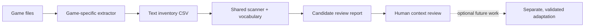

<div align="center">


# Muslim-Friendly Lore Scanner

### Find the lore that deserves a closer look.

One reusable text scanner. A growing vocabulary. **A human in control of every decision.**

[](https://github.com/Ghady04/muslim-friendly-lore-scanner)
[](https://nodejs.org/en/about/previous-releases)
[](#current-scope)
[](LICENSE)

[Quick start](#-quick-start) · [How it works](#-how-it-works) · [Limits and safety](#-limits--safety) · [Contribute](CONTRIBUTING.md)

</div>

---

## The idea

Mythology-heavy games can weave religious language, divine characters, worship, and ritual into item text, dialogue, quests, and world lore. Finding those references by hand is slow—and a keyword match alone can be misleading.

**This project turns extracted game text into a review queue.** It helps players and modders spot possible concerns while keeping context, judgment, and every edit in human hands.

> **Search broadly. Review carefully. Change only what you choose.**

## ✨ What you get

| | Capability | What it means |
|---|---|---|
| 🔎 | **Broad candidate search** | A categorized English vocabulary covering religious language, practices, and names from many myth traditions. |
| 🧾 | **Traceable findings** | Each result keeps the source filename and available entry IDs beside the matched wording. |
| 🧠 | **Human-led review** | Matches are review leads—not religious rulings, verdicts, or automatic replacements. |
| 🔌 | **Shared input format** | Different game extractors can feed the same scanner using a simple CSV contract. |
| 🛡️ | **Read-only scanning** | The scanner reads supplied inventories and writes reports; it does not patch game files. |
| 📦 | **Lightweight setup** | Node.js only; no package installation or external runtime dependencies. |

## ⚡ Quick start

### 1. Install Node.js

Install a supported [Node.js LTS release](https://nodejs.org/en/about/previous-releases), version **22 or newer**.

### 2. Get the project

Download this repository with Git:

```bash
git clone https://github.com/Ghady04/muslim-friendly-lore-scanner.git
cd muslim-friendly-lore-scanner
```

Or use GitHub’s **Code → Download ZIP** button and extract the folder.

### 3. Run the fictional sample

From the project folder, run:

```powershell
node .\scanner\index.js .\examples\sample-inventory.csv --out .\.work\sample-report
```

The scanner checks three fictional rows. It should flag the sample line containing “gods” and “worship,” and leave the neutral warrior line alone. The report is created in `.work/sample-report/`:

- `candidate-review.csv` — entries that matched one or more candidate terms.
- `scan-summary.json` — scan counts, lexicon version, and coverage notes.

Need the command options?

```powershell
node .\scanner\index.js --help
```

## 🧭 How it works



The scanner does **not** extract game archives or produce mods. The extractor is specific to each game’s file formats and rules. A future game can reuse the scanner once a compatible extractor creates the supported inventory format.

## 🧾 Give it your own text inventory

Create or export a CSV with a header and a text column named `source_text`, `text`, `content`, or `string`. Optional IDs make results easier to find again.

```csv
source_file,entry_id,bundle_id,category,source_text
dialogue.csv,42,main,character,"An ancient being watched from the tower."
```

Scan one or more inventories:

```powershell
node .\scanner\index.js .\exports\items.csv .\exports\dialogue.csv --out .\.work\review
```

To display proposed wording alongside matching entries, pass a separate proposal CSV:

```powershell
node .\scanner\index.js .\exports\items.csv --proposals .\proposals.csv --out .\.work\review
```

The proposal file needs `file`, `entry_id`, and `proposed_text` columns. Optional `status` and `rationale` fields are included in the report. **Proposals are displayed only; nothing is applied.**

## 🧩 Making it work across games

“Universal” means a shared review engine and a growing set of game-specific adapters—not a magic program that safely understands every new game on day one.

| Shared across games | Must be verified per game |
|---|---|
| Vocabulary and review workflow | How the game stores and encodes text |
| CSV inventory format | Which files contain dialogue, item text, or quest lore |
| Candidate report structure | Whether extraction or modification is allowed |
| Human review principles | How to preserve IDs, controls, formatting, and game behavior |

Unknown games should begin with **read-only reconnaissance**. Don’t guess at binary edits or treat a successful text scan as proof that a mod is safe to install.

## 🧠 Read findings with context

The current lexicon contains **910 term strings across 14 categories**. It includes broad words such as *grace*, *faith*, *lord*, and *spirit*, along with named figures and concepts from many traditions. That breadth is intentional: it helps surface possible references, but it also creates false positives.

- A word may be ordinary prose, a fictional name, a combat mechanic, or a culturally specific reference.
- A missing match may use an unlisted spelling, transliteration, language, image, voice line, or animation.
- Severity helps sort the queue; it does not decide what a Muslim player should accept.
- Review surrounding dialogue and story context before deciding whether anything needs changing.

This is a **growing English vocabulary, not “all myths.”** No static list can enumerate every tradition, local being, epithet, spelling, and language. We welcome carefully sourced additions and reports of missed terms.

## 🛡️ Limits & safety

> **No ban-proof promise. No “shirk-free” certification.**

This prototype scans only text already supplied to it. It does not inspect arbitrary binaries, scripts, subtitles that were not extracted, audio, textures, models, animations, cinematics, or other languages. A clean report is not proof that a game contains no relevant content. The project does not issue religious rulings.

Anti-cheat and publisher rules vary by game and can change. Offline mode does not guarantee permission or protection from account consequences. Never use this project to bypass DRM, anti-cheat, ownership checks, or access controls; do not load modified files in online or protected multiplayer. Check the current official rules for a title before any game-specific modification.

### Dark Souls Remastered

This repository contains **no DSR assets, extracted game text, save data, loader, or installable mod**. The [Steam DSR EULA](https://store.steampowered.com/eula/570940_eula_0) includes restrictions relevant to reverse engineering and modifications. This project does not claim that a DSR mod is publisher-authorized or ban-safe. Review the official terms before proceeding with any DSR-specific work.

## 🛠️ Project map

```text
scanner/
  index.js                    CLI scanner
  sensitivity_lexicon.json   Categorized English candidate vocabulary
  package.json                Runtime and sample command metadata
examples/
  sample-inventory.csv        Fictional starter inventory
docs/
  assets/lore-scanner-hero.png Project banner illustration
  ARCHITECTURE.md             Shared scanner and adapter boundaries
  DSR_AUDIT_STATUS.md         DSR scope and unverified areas
```

## 🤝 Help make the vocabulary better

Contributions are welcome: false-positive examples, missed spellings, documentation improvements, and safer adapter designs all help. Keep examples fictional or public-domain and never submit copyrighted game dumps, extracted inventories, save files, assets, binaries, credentials, or private user paths.

See [CONTRIBUTING.md](CONTRIBUTING.md) for the review guidelines. For the project direction and known limitations, start with [the architecture notes](docs/ARCHITECTURE.md).

## 📜 License

Original scanner code, vocabulary, and documentation are released under the [MIT License](LICENSE). This license does not grant rights to game content, third-party assets, or a publisher’s intellectual property.

<div align="center">

**Keep the atmosphere. Find the references. Let people decide what changes.**

</div>
